# PRD：美丽修行 · C 端 App 功能成级与架构

| 项 | 内容 |
|---|---|
| 产品 | 美丽修行（界面品牌文案常作「阅己美妆」） |
| 模块 | C 端 App 全量功能成级 / 信息架构 / 技术架构 |
| 文档版本 | V1.0 |
| 状态 | 基线说明（随功能迭代维护） |
| 作者角色 | 产品经理 + 工程对照 |
| 关联工程 | `美丽修行app/preview.html`、`美丽修行app/pages/**`、`美丽修行app/common/*-data.js`、根目录 `common/*-store.js`、`运营管理系统/preview.html`、`server/` |
| 关联文档 | `docs/工程目录与系统说明.md`；AI 子模块见 `docs/PRD-AI*.md`；自定义页见 `docs/PRD-自定义页面.md` |
| 演示入口 | 根目录 `index.html` → C 端 `美丽修行app/preview.html` |

---

## 1. 背景与一句话定义

### 1.1 背景

美丽修行是美妆内容 + 电商的 **H5 / uni-app 原型**：用户在 App 内完成「发现内容 → AI 选品/测肤 → 试用与购买 → 订单与售后 → 种草回写」；运营在 B 端配置商品、活动、社区、装修与 AI。双端以共享 `localStorage` Key 与 `common/*-store.js` 打通，可选 Node + MySQL 持久化。

### 1.2 一句话定义

**本 PRD 定义 C 端 App 的功能成级（信息架构）与系统/数据/交易/AI 架构，作为改页面、加模块、对运营联调的基线。**

### 1.3 产品能力域

| 能力域 | 定义 | 用户感知 |
|--------|------|----------|
| 内容社区 | 动态、种草、圈子、话题、文章、问答 | Tab「发现」 |
| 电商交易 | 商品、券、车、支付、订单、售后、评价 | 首页/盒/详情/我的 |
| 护肤 AI | 测肤、导购、客服、定制方案、撰写/识图（配置驱动） | 中心 Tab + 首页顶栏 |
| 个人资产 | 梳妆台、收藏清单、积分、消息、地址 | Tab「我的」 |
| 运营可控 | 功能入口、自定义专题页、活动货盘 | 装修同步到首页/我的 |

---

## 2. 目标与非目标

### 2.1 目标

1. 用 **5 Tab → 区块/子 Tab → 落地页/流程** 三级成级描述完整 C 端能力。
2. 标明每条主路径的 **页面路径、Store、localStorage Key、运营对端**。
3. 给出可评审的 **架构图（Mermaid）**，支撑后续 PRD 拆分与联调防漏。

### 2.2 非目标

- 不替代各 AI 子模块专项 PRD（导购/客服/测肤等细节以专项为准）。
- 不规定真实生产后端表结构（原型以 `app_store` KV + 演示字段为准）。
- 不把运营 admin 路由挂进 App `pages.json`。

---

## 3. 角色与端边界

| 角色 | 端 | 职责 |
|------|-----|------|
| C 端用户 | `美丽修行app/` | 浏览、发布、测肤、下单、售后、反馈 |
| 运营配置员 | `运营管理系统/` | 商品/订单/内容/装修/AI 配置与审核 |
| 共享层 | `common/` | Store、Sync、LLM、db-bridge |
| 可选后端 | `server/` | `:3789` ↔ MySQL `meilixiuxing.app_store` |

**边界约定**：涉及双端功能先定 Key / Store，再改两端 UI；App 打开运营用外链 `../运营管理系统/preview.html`。

---

## 4. 系统全景架构

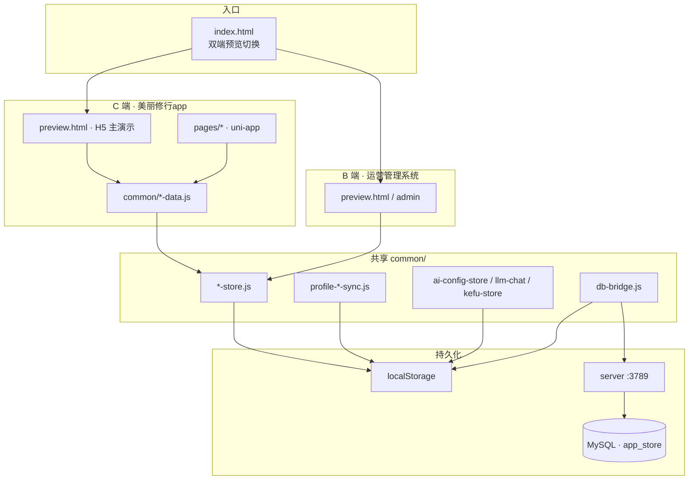

| 运行形态 | 说明 |
|----------|------|
| 日常演示优先 | 两端 `preview.html`（大单页） |
| uni 真页 | `美丽修行app/pages/**` + `pages.json` tabBar |
| 主题 | 主色约 `#8A63F2` / `#8B7CF6` |

---

## 5. 功能成级总览（信息架构）

**成级规则**

| 级 | 含义 | 示例 |
|----|------|------|
| L1 | 底部 Tab | 首页 / 发现 / 测肤 / 阅己盒 / 我的 |
| L2 | 页内区块或子 Tab | 顶栏快捷、发现「动态」、我的「订单」 |
| L3 | 落地页或流程节点 | 商品详情、支付密码、测肤报告、发布种草 |

```mermaid
flowchart TB
  APP["美丽修行 App · L0"]

  APP --> T1["L1 首页"]
  APP --> T2["L1 发现"]
  APP --> T3["L1 测肤"]
  APP --> T4["L1 阅己盒"]
  APP --> T5["L1 我的"]

  T1 --> H1["L2 顶栏快捷"]
  T1 --> H2["L2 搜索/提问"]
  T1 --> H3["L2 装修入口"]
  T1 --> H4["L2 内容双栏"]
  T1 --> H5["L2 热门推荐"]

  T2 --> D1["L2 动态"]
  T2 --> D2["L2 推荐"]
  T2 --> D3["L2 活动"]
  T2 --> D4["L2 发现"]
  T2 --> D5["L2 发布+"]

  T3 --> S1["L2 智能测肤入口"]
  T3 --> S2["L2 测谁弹层"]
  T3 --> S3["L2 拍照与报告链"]

  T4 --> B1["L2 Banner/测肤条"]
  T4 --> B2["L2 每周上新"]
  T4 --> B3["L2 大牌秒杀"]
  T4 --> B4["L2 猜你喜欢"]
  T4 --> B5["L2 新人专区"]

  T5 --> P1["L2 资料与设置"]
  T5 --> P2["L2 AI会员/新手任务"]
  T5 --> P3["L2 交易入口"]
  T5 --> P4["L2 方案/梳妆台"]
  T5 --> P5["L2 收藏清单"]
```

### 5.1 Tab ↔ 路由映射

| L1 | uni-app | preview.html | 职责摘要 |
|----|---------|--------------|----------|
| 首页 | `pages/home/index` | `data-tab="home"` | 搜索、AI 入口、防护、试用、商品流 |
| 发现 | `pages/discover/index` | `data-tab="discover"` | 社区 Feed、种草/圈子、活动、发布 |
| 测肤 | `pages/skin-test/index` | `data-tab="skin"` | AI 测肤中心入口（中心 Tab） |
| 阅己盒 | `pages/beauty-box/index` | `data-tab="box"` | 试用盒与促销专区 |
| 我的 | `pages/profile/index` | `data-tab="profile"` | 个人中心与交易资产 |

---

## 6. L1 模块规格

### 6.1 首页

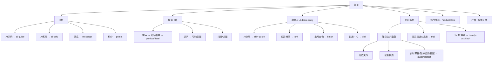

| L2 | L3 / 行为 | 工程落点 |
|----|-----------|----------|
| 顶栏快捷 | 导购/客服会话、消息列表、积分商城 | `pages/ai-guide`、`ai-kefu`、`message`、`points` |
| 搜索/提问 | 商品检索；提问走导购 | ProductStore；AI 配置 `daogou` |
| 装修入口 | 运营可配显隐/排序/跳转 | `decor-entry-store` / `decor-entry-data` |
| 防护指南 | 定位授权、防护页三 Tab | `guide/protect` |
| 试用/秒杀 | 试用中心、闪购 | `trial`、`beauty-box/flash` |
| 热门推荐 | 进详情 → 加购/下单 | `product/detail` |

**默认装修种子（首页）**：AI测肤、阅己榜单、批号查询、试用中心（`DECOR_ENTRY_SEED` scope=`home`）。

---

### 6.2 发现

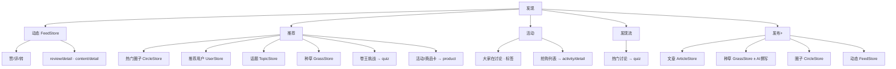

| 子 Tab | 内容源 | 备注 |
|--------|--------|------|
| 动态 | `yueji_feed_list_v2` | 仅展示审核通过 |
| 推荐 | 圈子/用户/话题/种草 | 可「换一批」 |
| 活动 | 活动列表 + 讨论标签 | 与 ActivityStore 对齐 |
| 发现 | 发现流 + 答题入口 | 与 quiz 互通 |

**内容闭环**：订单已评价 →「去种草」→ GrassStore → 运营种草管理；可标记 `grassPublished` / `grassId`。

**AI 撰写**：发布种草等场景可调「AI帮我写」，配置键见 `PRD-AI撰写.md`。

---

### 6.3 测肤

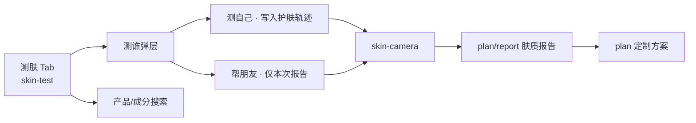

| 节点 | 路径 | 说明 |
|------|------|------|
| 入口 | `pages/skin-test/index` | 品牌「AI 妆小妍」 |
| 引导 | `pages/skin-guide/index` | 首页入口也可进 |
| 拍照 | `pages/skin-camera/index` | 正脸采集 |
| 报告/方案 | `pages/plan/report`、`plan/index` | 与「我的」定制方案打通 |

专项：`docs/PRD-AI测肤.md`。

---

### 6.4 阅己盒

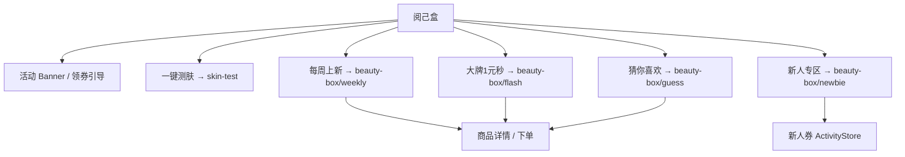

与首页「试用中心」「1元抢爆款」互通；悬浮客服/购物车/店铺为快捷入口（演示可 Toast）。

---

### 6.5 我的

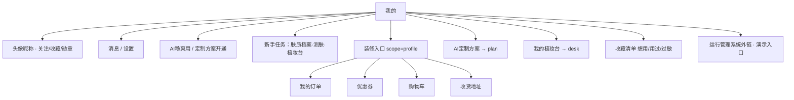

| L2 | L3 / 行为 | Store / Key |
|----|-----------|-------------|
| 订单 | 状态 Tab：待付款/待发货/待收货/已完成/售后中 | profile-order-sync |
| 订单动作 | 取消、付款、模拟发货、确认收货、评价、售后、物流、去种草 | order + review + aftersale + grass |
| 券/车/地址 | 领券中心、购物车结算、地址簿 | activity / cart |
| 收藏 | 想用 / 用过 / 过敏不适 | collect-store |
| 梳妆台 | 个人美妆库 | desk 页 |

**订单状态文案（须与运营对齐）**：待付款 / 已付款 / 待发货 / 确认收货（或待收货）/ 已完成。  
活动名不作商品标题。

---

## 7. 横切架构

### 7.1 页面路由总图（L3 池）

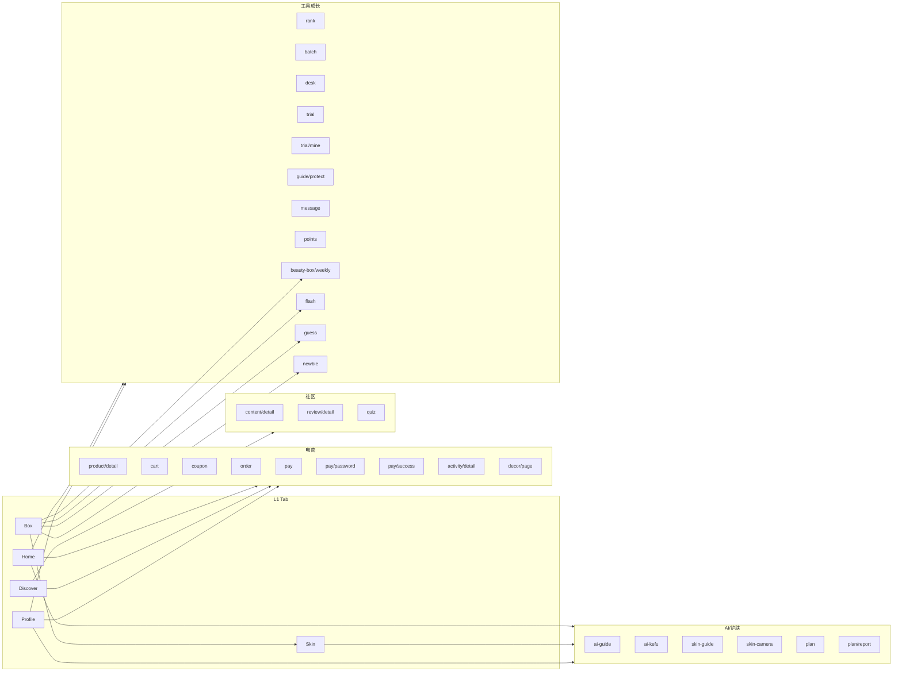

### 7.2 电商交易时序

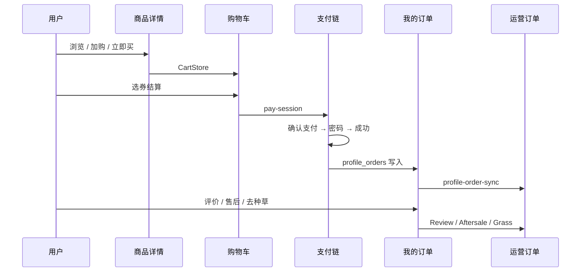

| 节点 | App 路径 | 共享层 |
|------|----------|--------|
| 商品 | `product/detail` | `product-store` |
| 购物车 | `cart/index` | `cart-store` |
| 券 | `coupon/index` | `activity-store` |
| 订单 | `order/index` | `order-store` + `profile-order-sync` |
| 支付 | `pay/*` | `pay-session`（App） |
| 售后 | 订单内 | `profile-aftersale-sync` |
| 评价 | 订单/详情 | `review-store` |

### 7.3 AI 能力矩阵

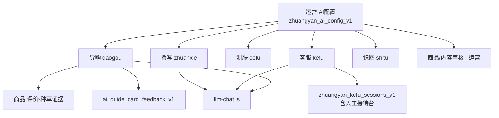

| 配置键 | PRD | App 入口 |
|--------|-----|----------|
| `daogou` | PRD-AI导购.md | 首页顶栏 / 提问 |
| `kefu` | PRD-AI客服.md | 首页顶栏 / 人工转接 |
| `cefu` | PRD-AI测肤.md | 测肤 Tab / 入口 |
| `zhuanxie` | PRD-AI撰写.md | 发现发布 |
| `shitu` | PRD-AI识图.md | 扫码/识图相关 |
| 审核 | PRD-AI商品审核 / AI内容审核 | 运营侧 |

### 7.4 装修与自定义页

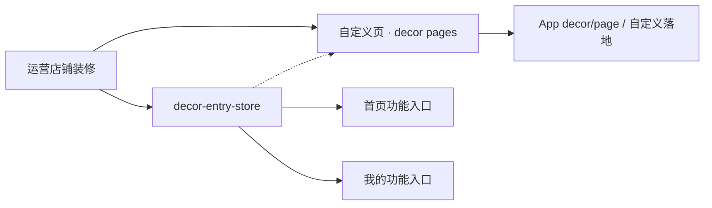

专项价值说明：`docs/PRD-自定义页面.md`。存储示例：`zhuangyan_decor_entries_v1`、`zhuangyan_decor_pages_v1`。

---

## 8. 数据架构

### 8.1 分层

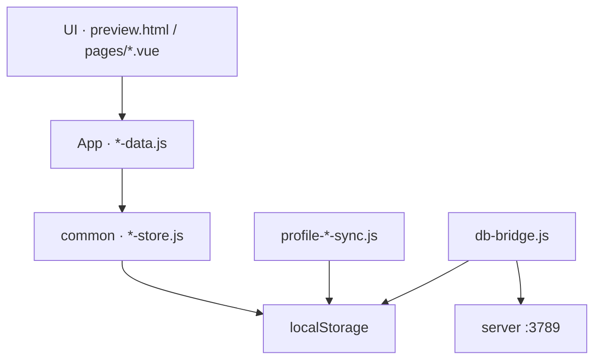

### 8.2 核心 Key（成级对照）

| 功能域 | Key | Store / Sync |
|--------|-----|--------------|
| 商品 | `zhuangyan_product_list_v1` | product-store |
| 运营订单 | `zhuangyan_order_list_v1` | order-store |
| 我的订单 | `zhuangyan_profile_orders_v1` | profile-order-sync |
| 购物车 | `zhuangyan_profile_cart_v1` | cart-store |
| 售后 | `zhuangyan_profile_aftersales_v1` | profile-aftersale-sync |
| 活动/券 | `zhuangyan_activity_list_v1` / `zhuangyan_claimed_coupons_v1` | activity-store |
| 评价/收藏 | `zhuangyan_review_list_v1` / `zhuangyan_collect_list_v1` | review / collect |
| 文章/种草/话题/圈子/动态 | `yueji_*_list_v2` | 对应 *-store |
| 用户 | `yueji_user_list_v4` | user-store |
| 装修入口 | `zhuangyan_decor_entries_v1` | decor-entry-store |
| AI 配置 | `zhuangyan_ai_config_v1` | ai-config-store |
| 导购反馈 | `ai_guide_card_feedback_v1` | ↔ 运营问题管理 |
| 客服会话 | `zhuangyan_kefu_sessions_v1` | kefu-store |
| 消息 | `yueji_message_list_v1` | message-data |

`db-bridge.js` 跟踪上表大部分 Key，需先启动 `server`。

---

## 9. 功能成级树（速查）

```
美丽修行 App
├── ① 首页
│   ├── 顶栏：AI导购 / AI客服 / 消息 / 积分
│   ├── 搜索（搜索｜提问）+ 扫码
│   ├── 装修入口：AI测肤 / 榜单 / 批号 / 试用中心
│   ├── 每日防护指南 → 定位 · 肤质 · 防护页
│   ├── 阅己优选&试用 / 1元抢爆款
│   └── 热门推荐 → 详情 → 交易
├── ② 发现
│   ├── 动态 Feed（互动 / 详情）
│   ├── 推荐（圈子 · 用户 · 话题 · 种草 · 问答）
│   ├── 活动（讨论标签 · 抢购）
│   ├── 发现流
│   └── 发布：文章 / 种草 / 圈子 / 动态（可 AI 撰写）
├── ③ 测肤
│   ├── 智能测肤入口
│   ├── 测自己 / 帮朋友
│   ├── 拍照测肤
│   └── 肤质报告 → AI 定制方案
├── ④ 阅己盒
│   ├── Banner / 测肤条
│   ├── 每周上新 / 大牌秒杀
│   ├── 猜你喜欢 / 新人专区
│   └── → 商品详情 / 交易
└── ⑤ 我的
    ├── 资料 / 消息 / 设置
    ├── AI 会员 / 新手任务
    ├── 订单 / 券 / 购物车 / 地址
    ├── AI 定制方案 / 梳妆台
    ├── 收藏清单（想用 · 用过 · 过敏）
    └── （演示）运行管理系统外链
```

---

## 10. 功能域 × 代码落点

| 功能域 | 主要页面 | App 封装 | 共享层 |
|--------|----------|----------|--------|
| 首页/搜索 | home | product-data, decor-entry-data | product / decor-entry |
| AI 导购/客服 | ai-guide, ai-kefu | — | ai-config, llm-chat, kefu |
| 测肤/方案 | skin-test, skin-camera, skin-guide, plan* | — | ai-config |
| 发现社区 | discover, content, review, quiz | feed/grass/topic/article-data | feed/grass/topic/circle/article |
| 阅己盒/试用 | beauty-box/*, trial* | activity-data, product-data | activity, product |
| 交易 | product, cart, coupon, order, pay* | cart/order/aftersale/pay-session | cart/order/activity + profile-*-sync |
| 个人资产 | profile, desk, points, message | user/points/message | user/collect/decor-entry |
| 工具 | rank, batch, guide/protect | — | product / 演示数据 |
| 专题 | decor/page | decor-page-data | decor-entry / decor pages |

---

## 11. 验收与改模块检查清单

新增或大改模块前须确认：

1. **成级位置**：落在哪个 L1/L2？是否需要新 L3 路由？
2. **运营对端**：列表/详情/配置是否要做？
3. **Store + Key**：是否新建？是否加入 `db-bridge`？
4. **Sync**：是否需要 App ↔ 运营回写（参考订单/售后）？
5. **双入口**：只改 `preview.html`，还是 `pages/` / `admin/` 一起改？
6. **演示字段**：缺字段用 `-` / `0.00` / 合理推导，不阻塞演示。
7. **文案**：订单状态与运营列表对齐；活动名不作商品标题。

---

## 12. 维护

| 规则 | 说明 |
|------|------|
| 大文件编辑 | 两个 `preview.html` 只做局部改，禁止整文件重写 |
| AI 细节 | 以对应 `PRD-AI*.md` 为准，本文只保留成级与入口 |
| 工程目录 | 目录约定以 `工程目录与系统说明.md` 为准 |
| 版本 | 成级变更时同步更新 §5–§9 与 §8 Key 表 |

| 版本 | 日期 | 说明 |
|------|------|------|
| V1.0 | 2026-09-04 | 首版：C 端功能成级 + 系统/交易/AI/数据架构（PRD 体例） |
